# YouTube Thumbnail Generator

### Thumbnails for the videos you already have, with the people in them looking the way they did back then.

<p align="center">
  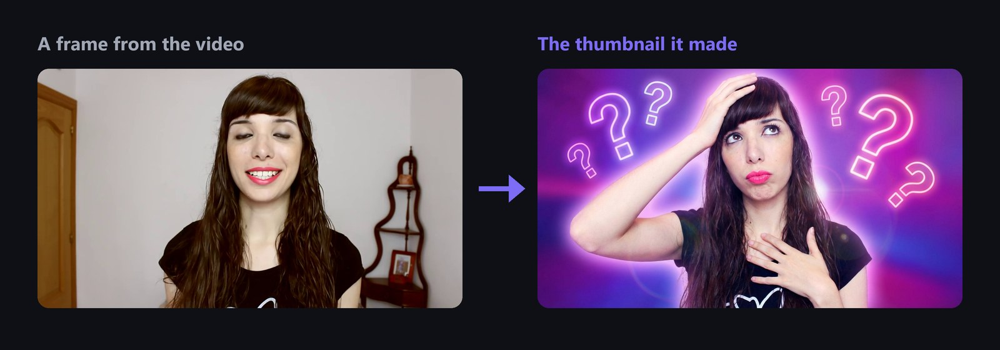
</p>

Point it at a folder of videos. It finds who appears in each one, picks their best frames, reads what the video is about and proposes thumbnails, titles and descriptions. Run it with cloud models, with local models on your own GPU, or with a mix of both.

<table>
<tr>
<td>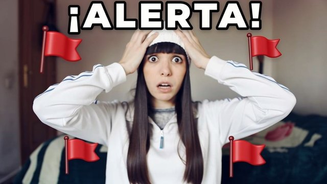</td>
<td>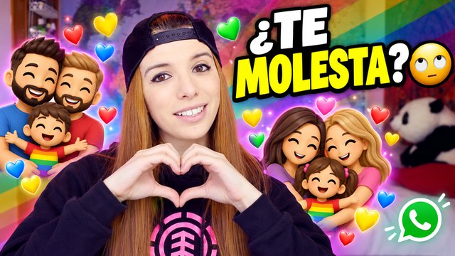</td>
<td>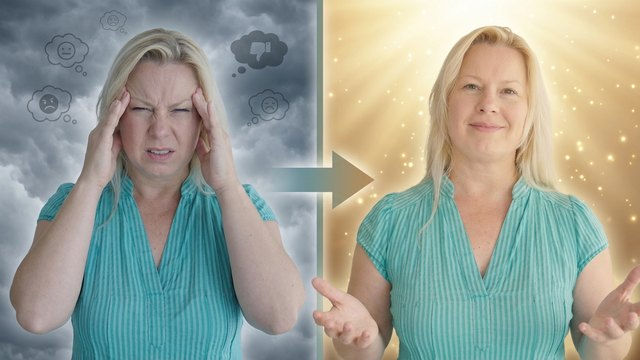</td>
</tr>
<tr>
<td>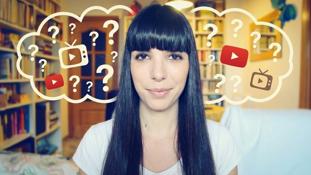</td>
<td>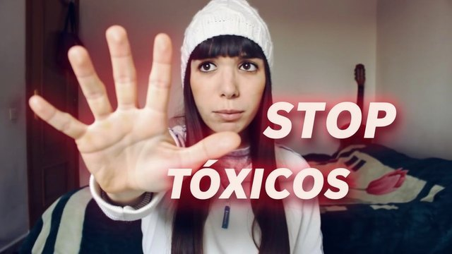</td>
<td></td>
</tr>
</table>

<p align="center"><sub>Real results: Mel in videos from her old channel, and Jhenny in her productivity videos. Every face comes from the frames of its own video.</sub></p>

---

## Why it's useful

- **The face from the video, not today's.** The reference photos come from the video itself, so a video recorded years ago gets a thumbnail of the person as they looked then. Different haircut, beard or age? No photo shoot needed.
- **Everyone who appears, sorted out for you.** It detects the people in each video on its own. The same person with a wig or a costume becomes a separate character, and faces that never move (paintings, posters) are flagged. Put one person or several in a thumbnail, rename them, merge them or create one from any frames.
- **Ideas from what the video actually says.** It transcribes the video and writes thumbnail concepts from its content: scene, pose, expression, props and text. Add your own instructions, a style image or a title for the thumbnails to follow.
- **Titles and descriptions too.** Several title styles (neutral, SEO, clickbait or your own), descriptions with chapter timestamps and hashtags, in the video's language or another one.
- **Cloud, local, or both.** Draw with Gemini, OpenAI, Poe or Replicate, or with ComfyUI on your own GPU. Write ideas and texts with Claude, GPT, Gemini, Grok, OpenRouter, or with Ollama and llama.cpp locally. Transcribe with Whisper on your machine or with ElevenLabs. With everything local, nothing leaves your computer and nothing is paid per image.
- **Made for whole channels.** A library of folders, analysis in the background, a task queue you can cancel, and a command line for batches.

---

## How it works

### 1. Add a folder and analyze it

<p align="center">
  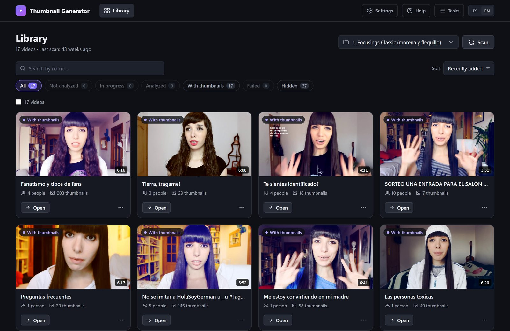
</p>

Add the folder where your videos are and analyze them. The analysis runs on your machine: it splits the video into scenes, finds every face, groups the faces into people and transcribes the audio.

### 2. Check who's who

<p align="center">
  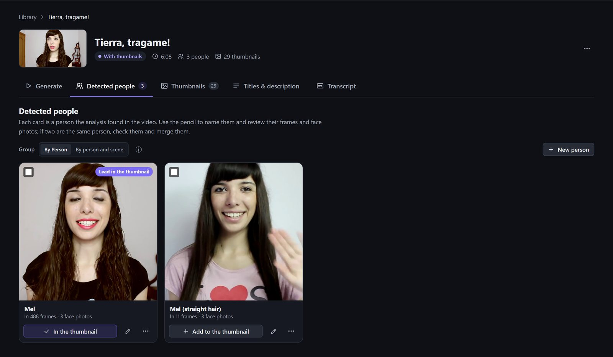
  <br><sub>The same person with two hairstyles in one video becomes two people, so you choose which look goes in the thumbnail.</sub>
</p>

For each person, the app picks the face photos the image model will get: the clearest frontal face of their usual look first, then others that add a head turn or another expression. It prefers open eyes, a relaxed mouth, sharp frames and faces nothing covers. The person editor shows every frame where they appear, with how much each one looks like them, and exactly what the AI will see. Change any photo, crop it, add a body photo or upload your own.

<p align="center">
  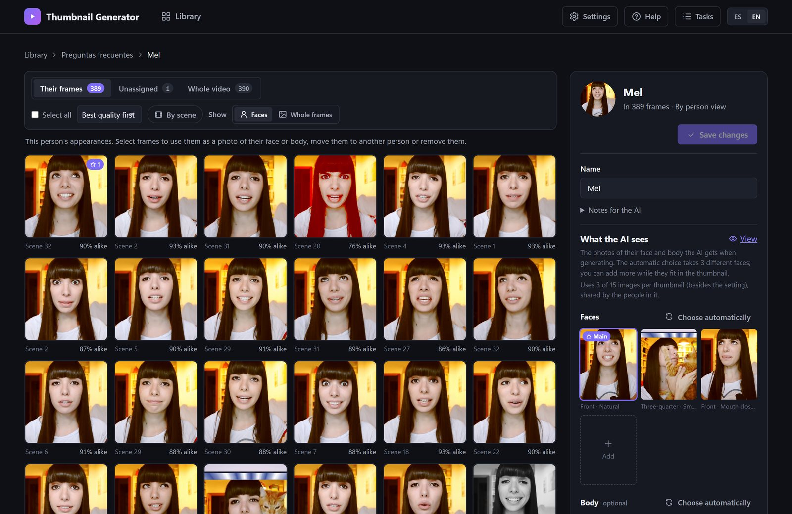
</p>

### 3. Generate

<p align="center">
  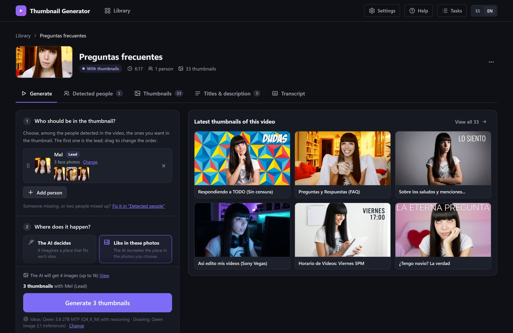
</p>

Choose who should be in the thumbnail, in order, and where it happens: let the AI imagine a place, or recreate the one in the video (or in a photo you upload). Then choose how many thumbnails you want. Each one is a different idea: another scene, pose and text. Optional settings let you pick the expression, a style image, the titles to follow, your own instructions, or keep new ideas different from earlier ones.

### 4. Pick, polish and publish

<p align="center">
  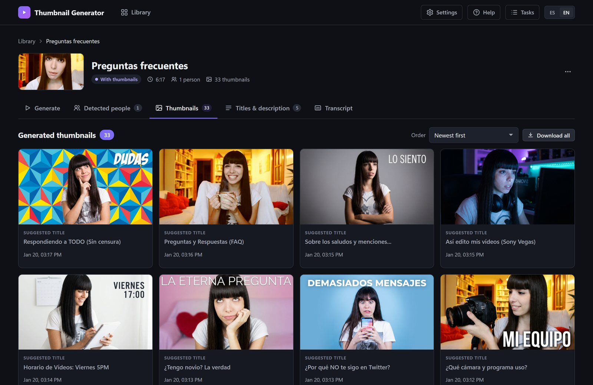
</p>

Browse the thumbnails, open them full size, download the ones you like or all of them. Every thumbnail is scored on how much its faces look like the real people, and the gallery can sort by it. If a face still needs help, the optional face swap puts the real face back. Hands, food or glasses in front of the face stay in front.

<p align="center">
  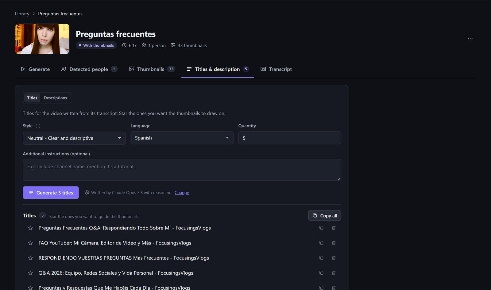
</p>

Titles and descriptions are written from the transcript. Star the titles you like and the next thumbnails will be designed around them.

---

## What people use it for

- **Archive and re-upload channels:** old videos whose thumbnails were lost, like the story below.
- **Creators whose look has changed:** keep each video's thumbnail true to the video.
- **Interviews, podcasts and duos:** several people in one thumbnail, each with their own photos.
- **Sketch and character channels:** costumes and wigs become characters you can pick.
- **People who manage several channels:** one library for many folders, also shared between computers.
- **Anyone who forgot to take the thumbnail photo.**
- **Only titles and descriptions:** for videos that already have a thumbnail.
- **Private material:** run everything locally when videos should not leave your computer.

---

## Choose your engines

Each job has its own engine, chosen in **Settings**:

| Job | Cloud | Local |
|-----|-------|-------|
| Thumbnail ideas (needs a model that sees images) | Claude, GPT, Gemini, Grok, OpenRouter | Ollama, llama.cpp, any OpenAI-compatible server |
| Drawing the thumbnail | Gemini (Nano Banana Pro, Nano Banana 2.1), OpenAI GPT Image, Poe (FLUX, Nano Banana, Ideogram...), Replicate | ComfyUI with Qwen Image 2.1, MiniMax H3 Image, or your own workflow |
| Titles and descriptions | Claude, GPT, Gemini, Grok, OpenRouter | Ollama, llama.cpp, any OpenAI-compatible server |
| Transcription | ElevenLabs (tells the speakers apart) | Whisper |

<p align="center">
  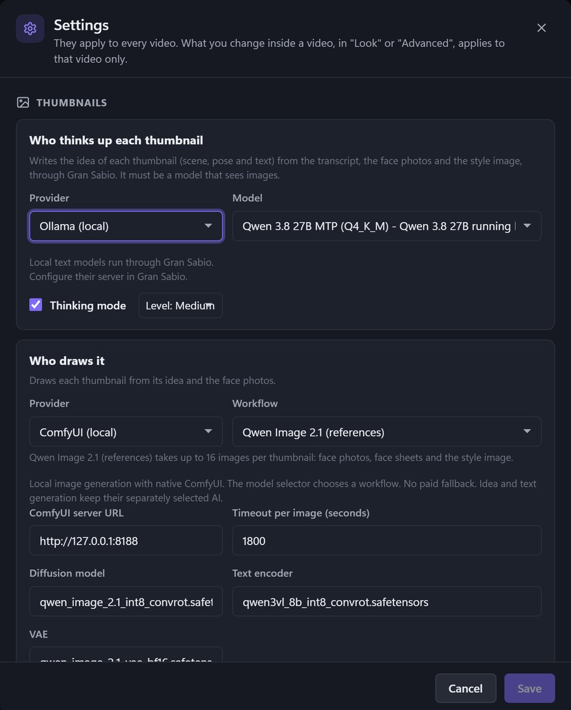
  <br><sub>Ideas with a local model in Ollama, drawing with Qwen Image 2.1 in ComfyUI.</sub>
</p>

Text models are reached through [Gran Sabio LLM](https://github.com/jordicor/GranSabio_LLM), so API keys and local servers are configured once there. When text and images share one GPU, Gran Sabio takes turns between them, and Settings can free a model's memory without stopping anything. Details in [ENGINES.md](ENGINES.md); ComfyUI setup and workflow profiles in [COMFYUI.md](COMFYUI.md).

The video analysis always runs locally. A cloud engine only receives what its job needs: the ideas model gets the transcript and the chosen photos, the image model gets the idea and the chosen photos, and the titles model gets the transcript.

---

## What runs on your machine

- **PySceneDetect** splits each video into scenes and keeps their frames.
- **InsightFace** finds the faces and tells people apart.
- **MediaPipe** judges each face (eyes, mouth, gaze, head turn) and reads hair, skin and clothes, to choose the best photos and spot wigs and disguises.
- **MediaPipe Pose and Mask R-CNN** find body photos where the person is clearly visible.
- **Whisper** transcribes, if you choose local transcription.
- **InSwapper, GFPGAN and XSeg** do the optional face swap and keep whatever covers the face in front.

Videos, frames, faces, thumbnails and the database stay in your `output/` folder and your SQLite file.

---

## Honest notes

- **Likeness depends on the image model and the photos it gets.** Some results look exactly like the person, others are only close. The app scores every thumbnail so you can see the weak ones first; check the face before you publish.
- **It stops instead of guessing.** A person without a face photo, or more photos than the model accepts, stops the job before anything is paid for; nothing is trimmed silently. If a provider refuses an image, the job stops there and shows the provider's reason. Falling back to another provider is an option you turn on.
- **Face swap is off by default.** It helps a weak face but can change the expression. The original thumbnail is always kept.
- **Model licenses are their own.** InsightFace's pretrained models, including InSwapper, are released for non-commercial research use. Check the license of every model you download.

---

## The story behind it

> **From 100 videos uploaded in 3 years... to batch-processing the remaining 178.**

In 2015-2016 I managed **FocusingsVlogs** (Mel Dominguez), a Spanish YouTuber with more than 240,000 subscribers. She later deleted her channel for personal reasons. I had a backup of almost all her videos, but not of the thumbnails.

In 2023 I suggested re-uploading them as a digital archive. She agreed, as long as I handled everything. The problem was making thumbnails for 278 videos:

- The original thumbnails were gone.
- The videos were 720p, with camera noise and little sharpness.
- Mel's appearance had changed a lot since she recorded them.
- Each thumbnail meant watching the video, finding good frames, upscaling, retouching and designing it in Canva.
- Image AI existed, but could not keep her face.

After three years of manual work, only 100 videos were up. When image models learned to keep a face from reference photos, I built the first version of this tool with Claude Code in 8 days (December 27, 2025 to January 4, 2026). It has kept growing since, around the same goal: thumbnails that look like the real person, for videos that already exist.

---

## Quick start

### Requirements

- **Python 3.11** and **FFmpeg** on your PATH (`winget install FFmpeg`, `sudo apt install ffmpeg` or `brew install ffmpeg`).
- **Redis** for the web interface's job queue (on Windows, Laragon, Docker or WSL).
- **[Gran Sabio LLM](https://github.com/jordicor/GranSabio_LLM)** for the thumbnail ideas, titles and descriptions, with your cloud API keys or your local model servers.
- **An image engine:** an API key for a cloud provider, or a ComfyUI server registered as a GPU resource in Gran Sabio ([COMFYUI.md](COMFYUI.md), [ENGINES.md](ENGINES.md)).
- **An NVIDIA GPU** is recommended. Everything works on CPU, only much slower. Local image generation needs a GPU with enough memory for the model you choose.

Windows 10/11 is the main target; Linux and macOS should work.

### Install

**Windows: use the guided installer.** Download or clone this repository, open a
PowerShell terminal in its folder, and run:

```powershell
powershell -NoProfile -ExecutionPolicy Bypass -File .\install.ps1
```

It explains each choice, creates separate Python environments, downloads the latest
GranSabio, sets up Redis through WSL or uses your existing server, and checks the result.
Then double-click **Start Thumbnail Generator.cmd**. Read the
[Windows installation guide](INSTALL_WINDOWS.md) for explanations, troubleshooting,
updates, and **non-interactive commands for AI agents**, including read-only JSON plans.

Manual installation (including other operating systems):

```bash
git clone https://github.com/jordicor/youtube_thumbnail_generator_with_AIs.git
cd youtube_thumbnail_generator_with_AIs

python -m venv venv
venv\Scripts\activate            # Windows
# source venv/bin/activate       # Linux/macOS

pip install -r requirements-cpu.txt
# NVIDIA: install the CUDA PyTorch build first, then requirements-cuda.txt.
# Then replace InsightFace's CPU ONNX runtime; see INSTALL_WINDOWS.md.

# Local models for choosing face and body photos
python scripts/download_portrait_model.py
python scripts/download_body_model.py
# Optional: face swap models (about 1 GB)
python scripts/download_face_swap_models.py

copy .env.example .env           # Windows
# cp .env.example .env           # Linux/macOS
```

InsightFace and Whisper download their own models the first time they run.

### Configure

Edit `.env`. The essentials:

```bash
# Gran Sabio LLM (ideas, titles and descriptions)
GRANSABIO_CLIENT_PATH=C:/path/to/GranSabio_LLM/client
GRANSABIO_LLM_URL=http://localhost:8000

# Default image engine: gemini, openai, poe, replicate or comfyui
IMAGE_PROVIDER=gemini
GEMINI_API_KEY=your-key            # only for the cloud engines you use
# COMFYUI_URL=http://127.0.0.1:8188

# Transcription: local Whisper, or ElevenLabs with ELEVENLABS_API_KEY
USE_LOCAL_WHISPER=true
WHISPER_MODEL=turbo
TRANSCRIPTION_LANGUAGE=en
```

`.env.example` lists every option. Everything else, including the models of each engine, is chosen in **Settings** inside the app.

### Run

Start Redis and Gran Sabio, then the web server and the worker, each in its own terminal:

```bash
python -m uvicorn api.main:app --host 127.0.0.1 --port 8057
arq workers.main.WorkerSettings
```

Open http://localhost:8057, add your video folder, and analyze. The interface is in English and Spanish.

---

## Command line and AI agents

The `process` command generates thumbnails directly from video files without the web interface or Redis. It reuses the analysis and generation stages, but does not register videos or results in the web database. Gran Sabio is still needed for the ideas.

```bash
python main.py process                           # every video in VIDEOS_DIR
python main.py process --single "path/to/video.mp4" --output "path/to/results"
python main.py process --dry-run                  # preview without writing files
python main.py process --num-images 5 --image-provider comfyui
```

`--output` controls all generated files, caches, and the pipeline log. Completed videos are skipped when their metadata and all thumbnail files are present. Use `--force-thumbnails` to generate new images while reusing analysis and ideas, or `--force-all` to rerun every stage. Processing stops at the first failure and exits with a nonzero status. Run `python main.py process --help` for the remaining options; a subcommand is always required.

The commands below operate on videos already registered in the web database. `generate` runs the web's generation service in the CLI process, including its job ownership checks. With `--json`, these commands print JSON with absolute file paths so an AI agent can inspect the frames and thumbnails:

```bash
python main.py list-videos --json
python main.py inspect --video 12 --json
python main.py list-clusters --video 12 --json
python main.py generate --video 12 --clusters 0,1 --num-images 3 --json
python main.py score-thumbnails --video 12 --json
```

### Tests

```bash
python -m pytest tests
```

The tests use synthetic data and mocked services; Node.js on the PATH is needed only for the interface tests. Never use personal videos or production API keys as test data.

---

## Other projects

- [**Acerting Art**](https://www.youtube.com/@AcertingArt): 430K+ subscribers, relaxation and meditation music.
- [**GranSabio LLM**](https://github.com/jordicor/GranSabio_LLM): multi-provider LLM engine with multi-layer quality checks.
- [**VR Relaxation Space Room**](https://jordicor.itch.io/acerting-art-vr-relaxation-space-room): VR meditation app (Unity/Maya).
- [**Neo Atlantis**](https://github.com/jordicor/neo-atlantis): RPG game with 200+ 3D models (1999).
- [**Security Research Archive**](https://github.com/jordicor/security-research-archive): 6 vulnerabilities, 2 CVEs (2004-2006).

## License

MIT License. Use it freely; attribution is appreciated. The models it downloads keep their own licenses.

## Acknowledgments

- **Mel (FocusingsVlogs)** for trusting me with her archive, and **Jhenny** for letting her videos appear here.
- **Claude Code**, which made the first version possible in a week.
- The open-source projects behind InsightFace, MediaPipe, PySceneDetect, Whisper, ComfyUI, Qwen Image, GFPGAN and FaceFusion's occluder models, and **ElevenLabs** for its speech-to-text API.

---

<p align="center">
  <i>Built with obsession, automation, and a healthy disregard for manual labor.</i>
</p>

<p align="center">
  <a href="https://github.com/jordicor">GitHub</a> ·
  <a href="https://jordicor.com">Website</a> ·
  <a href="https://www.youtube.com/@AcertingArt">YouTube</a>
</p>
